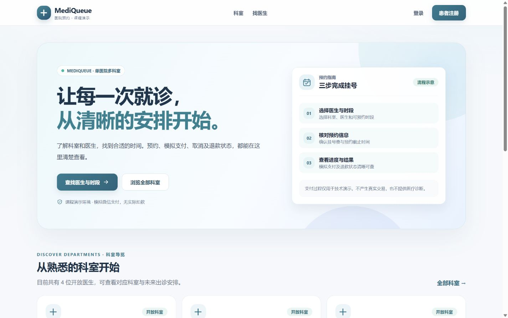

# MediQueue

English · [简体中文](README.md)

**A Laravel + MySQL hospital appointment application that makes transactions, row locks, and idempotency visible through real concurrency tests.**

[](https://github.com/SynapseOperator/MediQueue/actions/workflows/ci.yml)
[](LICENSE)
[](composer.json)
[](composer.json)
[](docs/development/release-validation.md)



- **One seat, twenty contenders.** Independent PHP processes and MySQL connections compete for the final seat; the test requires exactly one appointment, one order, and one capacity increment.
- **Protect the patient as well as the slot.** A patient mutex prevents overlapping appointments with different doctors. A shared lock order coordinates booking, suspension, payment, cancellation, and expiry.
- **Retries keep their identity.** Case-sensitive request keys deduplicate creation. An uncertain commit is looked up before retrying; refund retries reuse the original obligation.
- **Database work you can inspect.** Ten core tables, constraints, two views, a procedure, a function, measured query plans, and an isolated backup/restore experiment.
- **An end-to-end application.** Patient booking and simulated payment, a read-only doctor workspace, and administration for resources, refunds, analytics, and audit history, with responsive pages.

This is an educational project using synthetic data. **All payments and refunds are simulated; no money moves.** It is not a clinical system or a real WeChat Pay integration. The test badge links to recorded regression results; use CI for the current commit's results. The application UI currently uses Simplified Chinese. Watch the [90-second captured workflow GIF](docs/demo.md), presented as actual interaction highlights rather than a continuous screen recording.

## Quick start

Install Docker Engine / Docker Desktop and Docker Compose, then run:

```sh
git clone https://github.com/SynapseOperator/MediQueue.git
cd MediQueue
docker compose up --build
```

Open **http://localhost:8080**. The application, MySQL, and expiry scheduler start together. First startup migrates an isolated demo database, seeds synthetic records, and prints randomly generated patient, doctor, and administrator credentials in your terminal. You do not need PHP, Composer, Node, or a hand-written environment file on the host.

The demo uses its own Docker volumes. Restarts preserve existing accounts, passwords, and history. `docker compose down` stops it; adding `-v` deletes this demo's persisted volumes, so only do that intentionally. See [environment modes](docs/development/environments.md) for optional settings and the walkthrough.

[](https://codespaces.new/SynapseOperator/MediQueue)

The [.devcontainer](.devcontainer) configuration supports Codespaces and VS Code Dev Containers. For manual PHP/MySQL setup, the full test suite, or separate migration/runtime privileges, use the optional [strict setup](docs/development/strict-mode.md).

## Designs worth reading

- [Atomic booking](docs/design/concurrency.md#一次预约的事务): a guarded capacity update, appointment, payment order, and audit record commit together.
- [Patient serialization and lock order](docs/design/concurrency.md#锁顺序): two different doctors cannot bypass the same patient's interval check.
- [Idempotency and uncertain commits](docs/design/concurrency.md#幂等与提交结果未知): a lost response does not mean that no data was written.
- [Payment, expiry, and refund races](docs/design/concurrency.md#几个真实竞态): concrete outcomes with links to the tests that exercise them.
- [What CHECK constraints cannot do](docs/design/concurrency.md#约束的职责与边界): cross-row and cross-table rules still require protected transactions.

The detailed design and course materials currently remain in Chinese; source identifiers, SQL, and Mermaid diagrams are readable independently.

## Documentation

| Topic | Entry point |
|---|---|
| Demo roles, simulated payments, and refunds | [Environment and walkthrough](docs/development/environments.md) |
| Transaction reasoning and concurrency tests | [Concurrency design](docs/design/concurrency.md) |
| Relationships, fields, and historical records | [ER diagram and schema](docs/architecture/p1-database-schema.md) |
| Views, routines, and metric definitions | [SQL objects](docs/database/p5-sql.md) · [Analytics](docs/architecture/p5-analytics.md) |
| Measurements on 50,000 synthetic appointments | [Performance experiment](docs/performance/p6-report.md) |
| Acceptance, restore evidence, and course report | [Archive index](docs/archive/README.md) · [Editable report](docs/report/MediQueue-course-report.md) |
| Setup, tests, and contributions | [Strict setup](docs/development/strict-mode.md) · [Contributing](CONTRIBUTING.md) |
| Decisions, future work, and releases | [ADRs](docs/architecture) · [Roadmap](ROADMAP.md) · [Changelog](CHANGELOG.md) |

Ask design questions in [Discussions](https://github.com/SynapseOperator/MediQueue/discussions) and report reproducible problems in [Issues](https://github.com/SynapseOperator/MediQueue/issues). For vulnerabilities, follow [SECURITY.md](SECURITY.md).

AI coding agents assisted development. The repository keeps its design constraints and verifiable evidence in [development notes](docs/development). Licensed under the [MIT License](LICENSE).
