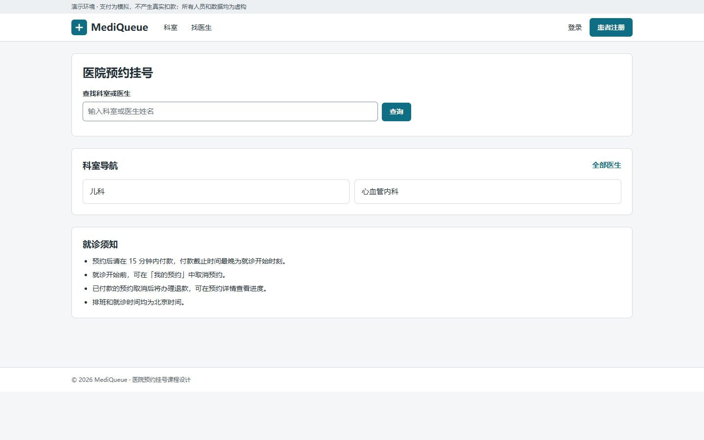
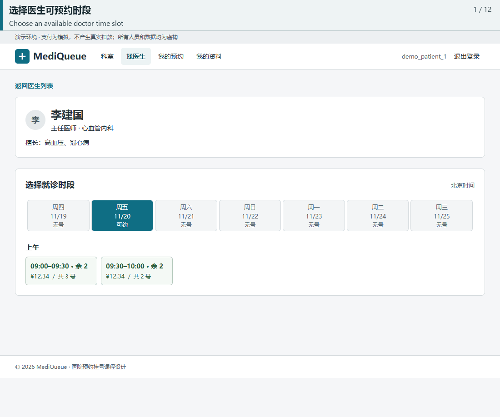

# MediQueue

[English](README.en.md) · 简体中文

**基于 Laravel + MySQL 的医院预约挂号系统，用真实并发测试展示事务、行锁与幂等设计。**

[](https://github.com/SynapseOperator/MediQueue/actions/workflows/ci.yml)
[](LICENSE)
[](composer.json)
[](composer.json)
[](docs/development/release-validation.md)



- **竞争的是最后一个名额。** 20 个独立 PHP 进程、20 位患者同步竞争，验证恰好一条预约、一条订单和一次占号。
- **保护患者，也保护号源。** 患者级串行化阻止跨医生时间冲突，统一锁顺序协调预约、停诊、付款、取消与回收。
- **重试不会变成第二笔业务。** 请求键区分大小写；未知提交先核对原记录，取消和退款重试沿用原业务身份。
- **数据库成果可以核对。** 十张核心表、CHECK/外键/唯一约束、两视图、一过程、一函数，以及真实 EXPLAIN 和隔离恢复记录。
- **可以完整体验。** 患者挂号与模拟支付、医生只读工作台、管理员资源管理、退款、统计和审计，支持手机布局。

这是使用合成资料的课程与工程学习项目。**模拟微信支付／无实际扣款**，不接入真实商户，也不用于真实诊疗。测试徽章对应链接中的实际回归结果；当前提交的执行结果以 CI 为准。

<details>
<summary>观看 90 秒演示 · 从预约挂号到退款重试</summary>



</details>

[直接打开 GIF](docs/images/ui-plain/appointment-refund.gif) · [操作记录与 v1.0.0 历史演示](docs/demo.md)

## 快速开始

安装 Docker Engine / Docker Desktop 与 Docker Compose，克隆后启动：

```sh
git clone https://github.com/SynapseOperator/MediQueue.git
cd MediQueue
docker compose up --build
```

打开 **http://localhost:8080**。应用、MySQL 和定时回收一起启动，首次初始化自动迁移、创建合成资料，并在终端显示本次随机生成的患者、医生和管理员登录凭据。无需预装 PHP、Composer 或 Node，也不必手工创建环境文件。

默认演示使用独立 Docker 数据卷；再次启动保留账户、密码和预约历史。关闭可用 `docker compose down`，不要添加 `-v`，除非确定要删除这一套演示数据。既有的本地业务库不会被此入口接管。详细配置与限制见 [演示与开发环境](docs/development/environments.md)。

[](https://codespaces.new/SynapseOperator/MediQueue)

Codespaces / VS Code Dev Containers 使用仓库中的 [.devcontainer](.devcontainer) 配置。独立安装 PHP/MySQL、运行完整测试或研究运行账号与迁移账号分离，请看 [严格模式](docs/development/strict-mode.md)。

## 值得一看的设计

- [条件占号与事务原子性](docs/design/concurrency.md#一次预约的事务)：容量更新、预约、订单和成功审计一起提交或回滚。
- [患者互斥与统一锁顺序](docs/design/concurrency.md#锁顺序)：不同医生的号源仍会对同一患者串行检查时间冲突。
- [`request_key` 幂等与未知提交](docs/design/concurrency.md#幂等与提交结果未知)：不把网络错误误认为写入失败，不盲目换键占号。
- [付款、过期与退款竞态](docs/design/concurrency.md#几个真实竞态)：用具体执行顺序解释合法结果，并链接对应测试。
- [CHECK 能保证什么](docs/design/concurrency.md#约束的职责与边界)：本行状态组合交给数据库，跨行和跨表语义仍由受锁保护的事务维护。

## 文档索引

| 想了解什么 | 从这里开始 |
|---|---|
| 使用三种角色、模拟付款与退款 | [体验指南](docs/development/environments.md) |
| 并发正确性的实现与测试 | [并发设计](docs/design/concurrency.md) |
| 表关系、字段和历史保护 | [ER 图与表结构](docs/architecture/p1-database-schema.md) |
| SQL 对象和统计口径 | [SQL 专项](docs/database/p5-sql.md) · [统计设计](docs/architecture/p5-analytics.md) |
| 5 万条合成记录上的真实查询测量 | [性能实验](docs/performance/p6-report.md) |
| 备份恢复、验收矩阵和课程报告 | [归档索引](docs/archive/README.md) · [课程报告源文件](docs/report/MediQueue-course-report.md) |
| 手动环境、测试和数据库权限分离 | [严格模式](docs/development/strict-mode.md) · [贡献指南](CONTRIBUTING.md) |
| 设计决定、后续方向、版本记录 | [ADR](docs/architecture) · [Roadmap](ROADMAP.md) · [Changelog](CHANGELOG.md) |

欢迎通过 [Discussions](https://github.com/SynapseOperator/MediQueue/discussions) 讨论设计，通过 [Issues](https://github.com/SynapseOperator/MediQueue/issues) 报告问题或寻找入门任务。安全问题请按 [SECURITY.md](SECURITY.md) 私下报告。

本项目使用 AI 编程代理辅助开发；设计约束、执行证据和复核要求见 [开发说明](docs/development)。代码采用 [MIT License](LICENSE)。
