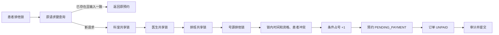

# ADR-0004：P3 预约原子事务与锁协议

- 日期：2026-11-17；基线 main `516af650bbf11d6aafb7dde4f590420317b3121d`
- 依据：PRD V1.1 BR-01/02/03/05/07/08、AC-03/04/05/06/07/14/20；数据库 V1.1 TX-01、TX-06、6.8。
- 范围：只实现创建待支付预约及读取本人记录；没有改动 P1 migration 或十张核心表，没有实现 P4 状态转换。

## 单一写入口

`AppointmentService::create(userId, slotId, requestKey)` 是预约创建的唯一业务入口。HTTP 先执行 Session、active、PATIENT 和 CSRF 校验，只接受号源 ID 与请求键；患者 ID 从当前账号查询。本人列表和详情均从 `patients.user_id = 当前用户` 限定，无以编号替代授权的查询。

请求键入口限定 16–64 位 ASCII 字母、数字、下划线或连字符，排除全局 TrimStrings，原样保留大小写。沿用 P1 `(patient_id, request_key)` binary / NO PAD 唯一键；不添加 `(patient_id, slot_id)` 永久唯一性。当前唯一业务输入是 slot_id，费用和身份均由服务端确定；旧键指向不同号源拒绝。同键同输入返回实际旧记录，包括 CANCELLED/EXPIRED，不复活或续期。

## 事务及时间

关联 ID 的候选查询不加锁；拿到父子资源锁后重新验证归属、状态、日期窗口和区间边界。账号状态用共享保护：患者锁后取本人账号，医生锁后取医生账号。只使用需要的节点，未在资源锁之后反向锁患者。

患者锁串行化同一患者跨科室、跨医生的创建；READ COMMITTED 下的冲突普通读看到前次已提交预约。先锁定目标时段再用其最新时间做最终冲突检查；其他历史时段的时间已由 P2 禁止修改，所以不需要反向锁其他号源。幂等查找只读，不提前给预约记录加锁。

冲突采用 `existing.starts_at < target.ends_at AND existing.ends_at > target.starts_at`。包括尚未到期的 PENDING_PAYMENT、CONFIRMED、COMPLETED；相邻允许；CANCELLED/EXPIRED 不阻断。按 PRD BR-01，到期但未回收 PENDING_PAYMENT 不再是有效时间冲突，然而仍完整计入该号源占用。这两个口径不能混用。

取得资源锁后读取服务端 UTC 毫秒时间；禁止开始时刻及之后的新预约。截止为 `min(created_at + 15 minutes, slot.starts_at)`，重试不能延长。日期窗口沿用 P2 配置，医院业务日期采用 Asia/Shanghai。

在已锁定 slot 后执行带 `occupied_count < capacity` 的条件增量更新；成功恰好一行。随后写预约、订单、白名单 APPOINTMENT_CREATED 审计，同一事务提交，任一步异常整体回滚。费用始终沿用 MySQL DECIMAL 返回的字符串，预约和订单复制同一快照，不做浮点运算。预约号/订单号使用各自前缀加 ULID；订单仅为 MOCK_WECHAT/UNPAID，外部资金字段保持 NULL。

## 与 P2 管理写入口的关系

P2 管理采用科室排他锁→医生→排班→号源；需要检查历史预约时再往后读/锁预约，且不会回头锁患者。P3 在共同父节点取得共享锁，P2 变更开放状态必须等待它释放，反之亦然。患者之间共享不变的上层资源，仅在患者或目标号源竞争排他保护。

实际审查了 P2 科室、医生、排班、号源路径、用户账号共享锁及插入外键隐式锁；当前没有发现反向等待环。P2 医生转科在已存在排班时被禁止，创建预约所用父子关系不能被并发迁移。该结论是当前入口的审查结果，不承诺绝无死锁；未来 P4 必须遵守同一协议，不能锁着某号源再遍历锁患者。

## 重试与结果未知

沿用当前 Laravel `DB::transaction(..., 3)`：死锁或锁超时由框架回滚整个事务后最多尝试三次，重做患者锁、幂等与资格判断；耗尽时提示使用原请求标识重试。锁超时的数据库默认行为可能仅回滚语句，因此应用必须执行整事务回滚；已核对锁定版本的 `ManagesTransactions` 源码和 [MySQL 错误处理说明](https://dev.mysql.com/doc/refman/8.4/en/innodb-error-handling.html)。共享/排他读保护参考 [MySQL 锁定读](https://dev.mysql.com/doc/refman/8.4/en/innodb-locking-reads.html)。

连接丢失时提交结果可能未知：丢弃旧连接，重连后先按原账号与请求键只读查回。找到且输入一致就返回原预约；查不到或仍断线则明确提示未确认，并保留原键，不在该恢复分支自动重新占号。后续携原键重试仍先取得患者锁并检查幂等。本人列表用于人工查回；本阶段不添加重试队列或新业务标识。

## P4 边界与实际证明

预约详情显示待支付、真实截止和页面加载时的服务端剩余秒数；到期/停诊时说明付款资格失效，没有付款成功按钮。截止不依赖浏览器时间。P3 未实现支付确认入口，不能把页面提示当作 P4 支付截止竞态已验收。

没有假回收、后台定时任务或手工改计数。P4 将在正式预约事务之外调用统一的按需回收服务，再进入本创建事务；回收每条记录仍按患者优先顺序完成状态、订单、释放与审计。不要提前添加无效果的生命周期接口。

真实 MySQL 验证包含：20 进程最后一号、同患者跨两科室医生、停诊先/预约先两种受保护顺序、真实第二连接锁超时、各写入故障回滚。提交响应丢失和死锁错误通过受控注入验证恢复机制，不冒充实际网络断线或人为制造的 InnoDB 死锁。详见 [P3 验证记录](../archive/verification/P3.md)。
