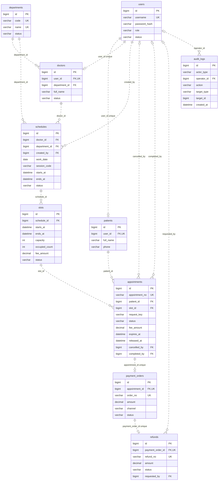

# P1 数据库结构与约束边界

本文说明 P1 对 V1.1 逻辑设计的数据库实现。业务依据为 [PRD V1.1](../spec/MediQueue_PRD_V1.1.md)，完整原始数据字典及事务协议见 [数据库设计 V1.1](../spec/MediQueue_Database_Design_V1.1.md)，支付身份与演示边界见 [模拟支付设计 V1.1](../spec/MediQueue_Mock_WeChat_Payment_Design_V1.1.md)。技术取舍见 [ADR-0002](adr-0002-p1-schema.md)。

P1 提供表、索引、约束、合成种子与数据库测试，不提供认证、Eloquent 业务模型、预约服务、支付网关或完整业务闭环。以下结构说明不是 PRD 全部 AC 已通过的声明；测试结果以阶段验证记录与对应 commit 的 CI 为准。

## 表范围与统一类型

核心业务表恰为十张：`users`、`patients`、`departments`、`doctors`、`schedules`、`slots`、`appointments`、`payment_orders`、`refunds`、`audit_logs`。`sessions` 与 `migrations` 为两张框架技术表，既不计入十张核心表，也不用于替代业务审计。

所有核心表使用 InnoDB、utf8mb4，默认排序规则为 `utf8mb4_0900_ai_ci`。除特别说明，以下约定适用于每张核心表：

| 项目 | 实现与含义 |
| --- | --- |
| `id` | `BIGINT UNSIGNED`、非空、自增、主键 |
| 外键字段 | 与被引用 `id` 相同的 `BIGINT UNSIGNED`；所有业务 FK 的更新、删除均为 `RESTRICT` |
| `created_at`、`updated_at` | 非空 `DATETIME(3)`；由写入方显式赋值，`audit_logs` 仅有 `created_at` |
| 业务事件时间 | `DATETIME(3)`；尚未发生时为 NULL，不使用空字符串或虚构时间 |
| 时间解释 | 保存和比较采用 UTC；`work_date` 为 Asia/Shanghai 医院当地日历日期 |
| 金额 | 非空 `DECIMAL(10,2)`，本期要求大于 0；订单币种仅 `CNY` |
| 状态 | `VARCHAR`，区分大小写的比较及合法值 `CHECK`，不采用散落的数字状态编码 |
| 业务标识 | 请求键、预约号、订单号、退款号、外部编号使用 `utf8mb4_0900_bin`；其 `NO PAD` 比较保留大小写及尾空格差异 |

`username` 使用默认 `utf8mb4_0900_ai_ci`，唯一性比较忽略大小写和重音差异。P2 必须让注册规范化与登录查找服从同一策略。手机号不作为患者身份唯一键。业务请求标识不能随意转换大小写；输入的有效格式和长度在后续入口校验。

除自增主键外，显式默认值为：users/departments/doctors 的 status=ACTIVE，schedules 的 status=DRAFT，slots 的 status=OPEN 与 occupied_count=0，appointments 的 status=PENDING_PAYMENT，payment_orders 的 currency=CNY、channel=MOCK_WECHAT 与 status=UNPAID，refunds 的 status=PENDING。其余非空字段没有业务默认值。DATETIME 本身不携带时区；写入方必须按约定转换为 UTC。

## ER 图：数据库实际关联

图中基数描述 FK/UNIQUE 能直接保证的关系。`o|` 表示零或一，`o{` 表示零或多；每条非空 FK 的子记录必须引用一个父记录，但父记录可以暂时没有子记录。非空 FK 加 UNIQUE 只保证“最多一条”，不能单独保证“至少一条”。

图为结构概览，完整类型、可空字段和复合唯一键在下文列出。用户角色与档案匹配、注册时建立患者档案、预约时建立支付订单，仍由后续服务事务保证。`audit_logs.target_type/target_id` 是多态逻辑目标，没有指向所有业务表的 FK。技术表 `sessions`、`migrations` 不在本业务 ER 图中。

## 十张核心表

下表均省略统一的 `id` 与通用时间字段；“否”表示 `NOT NULL`，“是”表示允许 NULL。`UQ` 表示唯一索引，`IDX` 表示普通索引。

### 1. [users](../../database/migrations/2026_11_16_010000_create_users_table.php)：登录账号

| 字段 | 类型 | 可空 | 约束或说明 |
| --- | --- | --- | --- |
| username | VARCHAR(64) | 否 | UQ(username)，默认 ai_ci 比较 |
| password_hash | VARCHAR(255) | 否 | 只保存密码哈希 |
| role | VARCHAR(16) | 否 | PATIENT / DOCTOR / ADMIN |
| status | VARCHAR(16) | 否 | ACTIVE / DISABLED |

CHECK 限定角色与状态集合。唯一用户名不证明自然人唯一；角色不能由未来普通注册入口任意指定。没有 email、身份证、默认 Laravel password 字段或多角色关联表。

### 2. [patients](../../database/migrations/2026_11_16_010001_create_patients_table.php)：患者资料

| 字段 | 类型 | 可空 | 约束或说明 |
| --- | --- | --- | --- |
| user_id | BIGINT UNSIGNED | 否 | FK→users.id；UQ(user_id) |
| full_name | VARCHAR(64) | 否 | 就诊展示名 |
| phone | VARCHAR(32) | 否 | 联系方式，不唯一 |

数据库保证引用存在、同一账号最多一份患者档案；姓名/联系方式的有效内容与用户角色在后续入口校验。没有强制身份证或家庭代挂号模型。

### 3. [departments](../../database/migrations/2026_11_16_010002_create_departments_table.php)：科室

| 字段 | 类型 | 可空 | 约束或说明 |
| --- | --- | --- | --- |
| code | VARCHAR(32) | 否 | UQ(code)，稳定编码 |
| name | VARCHAR(64) | 否 | UQ(name) |
| introduction | TEXT | 是 | 科室介绍 |
| status | VARCHAR(16) | 否 | ACTIVE / DISABLED |

CHECK 限定状态。被引用后 FK 阻止删除；业务停用与受影响排班处理由后续管理服务承担。

### 4. [doctors](../../database/migrations/2026_11_16_010003_create_doctors_table.php)：医生资料

| 字段 | 类型 | 可空 | 约束或说明 |
| --- | --- | --- | --- |
| user_id | BIGINT UNSIGNED | 否 | FK→users.id；UQ(user_id) |
| department_id | BIGINT UNSIGNED | 否 | FK→departments.id，当前科室 |
| full_name | VARCHAR(64) | 否 | 医生姓名 |
| title | VARCHAR(32) | 否 | 职称 |
| specialty | VARCHAR(255) | 是 | 擅长领域 |
| introduction | TEXT | 是 | 简介 |
| status | VARCHAR(16) | 否 | ACTIVE / DISABLED |

CHECK 限定状态；IDX(department_id, status, id) 服务于科室医生列表。医生角色匹配和只读权限不由 FK 实现。历史出诊科室从 `schedules.department_id` 读取，不随医生当前科室变化。

### 5. [schedules](../../database/migrations/2026_11_16_010004_create_schedules_table.php)：排班

| 字段 | 类型 | 可空 | 约束或说明 |
| --- | --- | --- | --- |
| doctor_id | BIGINT UNSIGNED | 否 | FK→doctors.id |
| department_id | BIGINT UNSIGNED | 否 | FK→departments.id，该次出诊科室 |
| work_date | DATE | 否 | 医院当地日期 |
| session_code | VARCHAR(16) | 否 | MORNING / AFTERNOON / EVENING |
| starts_at、ends_at | DATETIME(3) | 否 | UTC 起止时间 |
| status | VARCHAR(16) | 否 | DRAFT / OPEN / SUSPENDED / CLOSED |
| suspend_reason | VARCHAR(255) | 是 | SUSPENDED 时必须提供原因 |
| created_by | BIGINT UNSIGNED | 否 | FK→users.id；管理员身份须业务验证 |

UQ(doctor_id, work_date, session_code) 防重复班次；IDX(department_id, work_date, status) 支持按历史出诊科室和日期查询。四项 CHECK 限定班次/状态、`ends_at > starts_at`，以及 SUSPENDED 时原因非 NULL、`CHAR_LENGTH(TRIM(suspend_reason)) > 0`。其他状态可保留历史停诊原因。

这些约束不能判断不同班次之间是否重叠、是否跨医院当地日期，或科室快照是否取自创建时医生归属。已有预约后禁止改医生/时间/父子关系，也是后续受锁保护的写入口职责。

### 6. [slots](../../database/migrations/2026_11_16_010005_create_slots_table.php)：时段与容量

| 字段 | 类型 | 可空 | 约束或说明 |
| --- | --- | --- | --- |
| schedule_id | BIGINT UNSIGNED | 否 | FK→schedules.id |
| starts_at、ends_at | DATETIME(3) | 否 | UTC 起止时间 |
| capacity | INT | 否 | 大于 0 |
| occupied_count | INT | 否 | 默认 0，0≤值≤capacity |
| fee_amount | DECIMAL(10,2) | 否 | 大于 0 |
| status | VARCHAR(16) | 否 | OPEN / CLOSED |

UQ(schedule_id, starts_at) 防同排班重复起点。CHECK 保护时间正序、容量范围、金额及状态。时段位于排班内、同排班时段不重叠、上层可售资格须服务验证。容量数量范围合法不代表账实一致；已完成记录仍消耗名额。

### 7. [appointments](../../database/migrations/2026_11_16_010006_create_appointments_table.php)：预约历史

| 字段 | 类型 | 可空 | 约束或说明 |
| --- | --- | --- | --- |
| appointment_no | VARCHAR(40) | 否 | UQ(appointment_no)，binary NO PAD |
| patient_id | BIGINT UNSIGNED | 否 | FK→patients.id |
| slot_id | BIGINT UNSIGNED | 否 | FK→slots.id |
| request_key | VARCHAR(64) | 否 | binary NO PAD；与 patient_id 组成 UQ |
| status | VARCHAR(24) | 否 | PENDING_PAYMENT / CONFIRMED / CANCELLED / EXPIRED / COMPLETED |
| fee_amount | DECIMAL(10,2) | 否 | 创建时金额快照，大于 0 |
| expires_at | DATETIME(3) | 否 | 实际付款截止 |
| confirmed_at | DATETIME(3) | 是 | 历史确认时间 |
| cancelled_at | DATETIME(3) | 是 | 取消时间 |
| cancelled_by | BIGINT UNSIGNED | 是 | FK→users.id |
| cancel_reason_code | VARCHAR(32) | 是 | PATIENT_REQUEST / CLINIC_SUSPENDED / ADMIN_CORRECTION |
| cancel_reason | VARCHAR(255) | 是 | 管理员异常处理说明 |
| released_at | DATETIME(3) | 是 | 实际释放时间 |
| completed_at | DATETIME(3) | 是 | 完成登记时间 |
| completed_by | BIGINT UNSIGNED | 是 | FK→users.id |

UQ(patient_id, request_key) 保护请求身份；没有 UQ(patient_id, slot_id)，因此取消后可使用新请求键再次预约。状态/事件字段的本行一致性用 CHECK 表达；合法终态不表示后续服务可任意跳转。

八项 CHECK 保护状态、正数金额、截止上界及以下本行关系：

| 条件 | CHECK 保证 |
| --- | --- |
| 付款截止 | `created_at < expires_at <= created_at + INTERVAL 15 MINUTE`；就诊开始上界仍需关联 slots 验证 |
| 释放 | CANCELLED/EXPIRED 的 released_at 非 NULL；其余状态为 NULL |
| 确认 | CONFIRMED/COMPLETED 的 confirmed_at 非 NULL；PENDING_PAYMENT/EXPIRED 为 NULL；CANCELLED 可保留原确认时间 |
| 取消 | CANCELLED 的 cancelled_at、cancelled_by、cancel_reason_code 非 NULL；非取消状态的这三项及 cancel_reason 全部 NULL |
| 完成 | COMPLETED 的 completed_at/by 非 NULL；非完成状态均为 NULL |
| 取消原因 | 仅允许上述三个代码；CLINIC_SUSPENDED/ADMIN_CORRECTION 必须有去除普通空格后非空的 cancel_reason；PATIENT_REQUEST 的说明可空 |

已取消记录可以保留历史确认事实。取消/完成操作者权限、登记不早于时段开始、实际截止 `min(created_at + 15 分钟, starts_at)`、当前付款资格与跨表状态组合仍须业务验证。CHECK 不证明日期字段对应真实发生的事件，也不防止合法字段组合间的非法状态跳转。

普通查询索引：

| 索引 | 用途 |
| --- | --- |
| (patient_id, status, slot_id) | 当前患者冲突候选；关联 slots 后判断半开区间重叠 |
| (patient_id, created_at, id) | 患者历史分页 |
| (slot_id, status, expires_at, id) | 时段名单、目标时段按需回收、容量核对 |
| (status, expires_at, id) | 定时过期候选扫描，不依赖指定 slot |

### 8. [payment_orders](../../database/migrations/2026_11_16_010007_create_payment_orders_table.php)：模拟支付订单

| 字段 | 类型 | 可空 | 约束或说明 |
| --- | --- | --- | --- |
| appointment_id | BIGINT UNSIGNED | 否 | FK→appointments.id；UQ(appointment_id) |
| order_no | VARCHAR(40) | 否 | UQ(order_no)，binary NO PAD |
| amount | DECIMAL(10,2) | 否 | 大于 0，应等于预约金额快照 |
| currency | CHAR(3) | 否 | CNY |
| channel | VARCHAR(32) | 否 | MOCK_WECHAT |
| status | VARCHAR(24) | 否 | UNPAID / PAID / CLOSED / REFUND_PENDING / REFUNDED |
| external_txn_id | VARCHAR(128) | 是 | binary NO PAD；本期 CHECK 要求 NULL |
| paid_at | DATETIME(3) | 是 | 本地模拟付款事实时间 |
| external_paid_at | DATETIME(3) | 是 | 本期 CHECK 要求 NULL |
| closed_at | DATETIME(3) | 是 | 未支付关闭时间，保留历史事件 |

七项 CHECK 保护正数金额、币种、模拟渠道、状态、外部事实字段为 NULL，以及本行付款/关闭时间关系：PAID/REFUND_PENDING/REFUNDED 必须有 paid_at，UNPAID/CLOSED 必须没有；UNPAID 的 closed_at 必须为空，CLOSED 必须有值，其余状态允许保留关闭历史。

除两个业务 UQ 外，还建立 UQ(channel, external_txn_id)。当前模拟模式要求 external_txn_id 为 NULL，因此该键不是模拟付款幂等机制，也不表示真实渠道已经实现。IDX(paid_at, id) 用于模拟付款事实的时间查询，包括后来退款的订单。`REFUND_PENDING` 是尚未结清的退款义务，不能替代退款记录中的失败原因。退款不清空 `paid_at`。

数据库只能保证预约最多一个订单；创建预约与订单仍须同事务提交。金额跨表相等、订单与预约状态组合、可信服务端模拟事件、订单归属和付款截止属于 P3/P4 服务职责。本表不代表已经实现付款。

### 9. [refunds](../../database/migrations/2026_11_16_010008_create_refunds_table.php)：模拟退款义务

| 字段 | 类型 | 可空 | 约束或说明 |
| --- | --- | --- | --- |
| payment_order_id | BIGINT UNSIGNED | 否 | FK→payment_orders.id；UQ(payment_order_id) |
| refund_no | VARCHAR(40) | 否 | UQ(refund_no)，binary NO PAD |
| amount | DECIMAL(10,2) | 否 | 大于 0，应为原订单全额 |
| status | VARCHAR(16) | 否 | PENDING / SUCCEEDED / FAILED |
| reason_code | VARCHAR(32) | 否 | 退款原因 |
| requested_by | BIGINT UNSIGNED | 是 | FK→users.id，系统发起可空 |
| external_refund_id | VARCHAR(128) | 是 | binary NO PAD；本期 CHECK 要求 NULL |
| succeeded_at | DATETIME(3) | 是 | 仅 SUCCEEDED 时有值 |
| last_error | VARCHAR(255) | 是 | 脱敏错误或待核实说明 |

四项 CHECK 保护正数金额、状态、成功时间及模拟边界：SUCCEEDED 的 succeeded_at 非 NULL，PENDING/FAILED 为 NULL。`reason_code` 为 binary 字符串，本阶段未冻结代码枚举或对其加枚举 CHECK。IDX(status, created_at, id) 支持待处理退款查询。PENDING 可以带结果未知的说明，不能把超时直接当成成功或失败。UQ(payment_order_id) 限定同一订单最多一个全额退款业务记录；重试原记录，不能新增第二份义务。退款额与订单相等、付款事实已发生仍须后续服务验证。

### 10. [audit_logs](../../database/migrations/2026_11_16_010009_create_audit_logs_table.php)：关键操作审计

| 字段 | 类型 | 可空 | 约束或说明 |
| --- | --- | --- | --- |
| actor_type | VARCHAR(16) | 否 | USER / SYSTEM |
| operator_id | BIGINT UNSIGNED | 是 | FK→users.id；用户操作须关联操作者 |
| action | VARCHAR(64) | 否 | 受控动作名称 |
| target_type | VARCHAR(32) | 否 | 受控目标实体类型 |
| target_id | BIGINT UNSIGNED | 否 | 多态目标 ID，没有目标表 FK |
| before_state、after_state | JSON | 是 | 必要状态/数量等白名单详情 |
| request_id | VARCHAR(64) | 是 | 关联请求或任务 |
| created_at | DATETIME(3) | 否 | 发生时间；没有 updated_at |

两项 CHECK 保护 actor_type/操作者关系和目标类型。USER 必须有 operator_id；SYSTEM 可空，也可关联发起用户，有值时仍受 users FK 保护。target_type 只接受 users、patients、departments、doctors、schedules、slots、appointments、payment_orders、refunds，不将审计日志自身作为目标。`action` 和 `request_id` 使用 binary 字符串；action 在本阶段没有枚举 CHECK。

IDX(target_type, target_id, created_at, id) 用于追踪目标操作链。JSON 类型保证格式，不保证字段白名单或信息无泄露；这些由写入口控制。数据库不会自动记录审计，也不保证每次成功变更都有日志；服务必须在同一事务写入业务及审计。

## 技术表与数据库权限

`sessions` 沿用 Laravel session 存储：`id VARCHAR(255)` 主键，`user_id BIGINT UNSIGNED NULL` 索引，`ip_address VARCHAR(45) NULL`，`user_agent TEXT NULL`，`payload LONGTEXT NOT NULL`，`last_activity INT NOT NULL` 索引。P1 保持 `user_id` 无业务 FK；会话可过期移除，并非预约历史。P2 实现认证时再审查会话与账号关联，不能把这个决定理解成放弃数据归属校验。

`migrations` 是框架维护的迁移记录：自增整型 `id` 主键、非空 `migration VARCHAR(255)` 和非空 `batch INT`。它与 `sessions` 不采用核心业务通用时间字段，也不改变十张业务表计数。

运行账号仅在应用库具有 SELECT/INSERT/UPDATE/DELETE；迁移账号负责应用库结构，测试账号负责专用测试库。FK RESTRICT 阻止破坏被引用历史，但它不禁止删除所有未被引用的末端记录，也不会禁止修改已有关系；不物理删除预约/订单/退款、不可变历史关联等规则必须由受控业务入口维护。本阶段没有以触发器代替应用生命周期服务。

## 索引的范围

主键、唯一索引及上文业务查询索引按规格职责建立。外键需要的支持索引由已有左前缀索引或 InnoDB 提供，不为同一职责无条件重复添加。候选索引已落地不等于已经完成性能优化：实际查询、数据分布、EXPLAIN/EXPLAIN ANALYZE 与测量在后续阶段提供，不承诺加速比例。

## 种子数据与下一阶段

演示种子只允许明确的 local/demo/testing 环境，并在同一事务中检查十张核心业务表全部为空后写入，拒绝重复初始化和覆盖已有历史。[DatabaseSeeder](../../database/seeders/DatabaseSeeder.php) 创建 2 个科室、2 名医生、3 名患者、1 名管理员、2 个排班及 4 个时段；账号共 6 个。使用“演示医生甲/乙”“演示患者甲/乙/丙”等合成姓名，联系方式为 `DEMO-PATIENT-001` 至 `DEMO-PATIENT-003`。每个账号独立生成随机密码，只保存哈希，不公开登录密码。

每个排班为医院次日 09:00—10:00，按 Asia/Shanghai 转为 UTC 写入；两个相邻半小时时段容量分别为 3、2，occupied_count 初始为 0。两个演示医生的时段费用分别为 12.34 元和 30.00 元，均为模拟数据。这里的半小时长度是种子样例，不把 PRD 的界面默认值提升为所有排班必须遵守的冻结规则。

P1 种子不创建预约、支付、退款或伪造业务成功审计，不运行未来预约/支付服务。后续完整演示数据需通过对应合法业务路径创建。

以下规则还需要服务与专门验收：注册角色/档案一致；患者跨医生时间互斥；排班/时段边界及不可变历史；锁内权威时间与 15 分钟截止；容量账实核对；预约与订单同事务；付款/取消/过期竞争；停诊逐项处理；人工完成；幂等输入匹配；退款失败与重试；审计白名单。P1 的数据库约束通过不等于这些业务规则已经实现。
