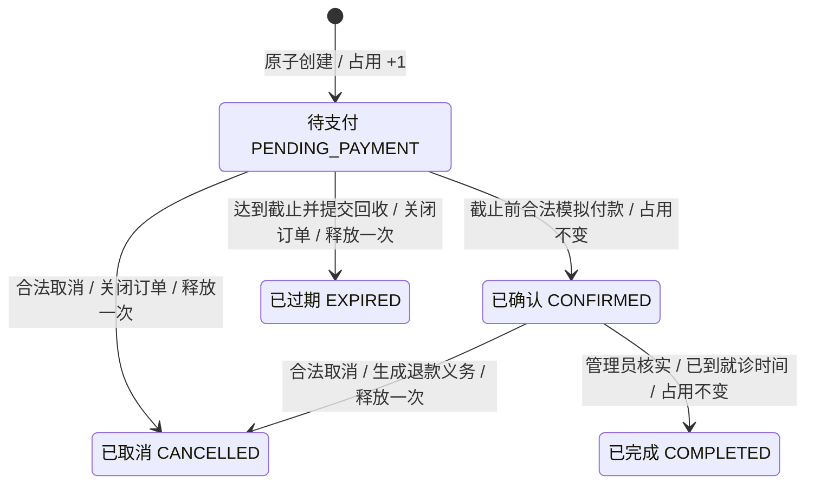
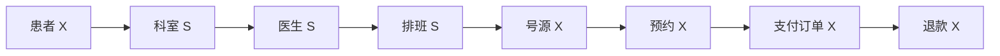

# 一个名额，二十个请求：MediQueue 的并发设计

预约系统最难的不是保存一条预约，而是在请求重试、付款、停诊和回收同时发生时，仍能解释每一个名额和订单。MediQueue 把这些修改收在 MySQL 短事务中，用同一套锁协议维护容量与状态，并用独立进程制造真实竞争。

这篇文档描述当前实现，不是通用支付系统的正确性证明。支付和退款均为本地 `MOCK_WECHAT` 模拟，不包含外部支付渠道的异步资金事实。

## 先明确不变量

1. `0 <= slots.occupied_count <= slots.capacity`。
2. 同一一致性快照中，`occupied_count` 等于该号源下 `PENDING_PAYMENT`、`CONFIRMED`、`COMPLETED` 预约的数量。
3. 成功创建的预约恰好对应一个业务订单；订单金额等于预约时保存的挂号费快照。
4. 同一患者的有效预约不能有重叠区间，包括不同医生。半开区间 `[start, end)` 允许相邻时段。
5. 取消与过期释放一次，付款与完成不再次占号，也不回补名额。

“付款资格过期”与“名额已经释放”是两件事。到达截止后不能付款，但尚未完成回收事务的待支付记录仍计入存储占用。核对视图只报告差异，不修改计数掩盖错误。

## 预约状态机



取消、过期、完成均不提供复活旧预约的入口。取消后再次预约需要新的请求键和新的预约记录。停诊不是预约状态：它修改排班资格，阻止新的预约及待支付付款，已存在的预约仍按原规则逐项处理。

模拟退款单独记录 `PENDING / FAILED / SUCCEEDED`。退款失败后预约仍是 `CANCELLED`，订单仍是 `REFUND_PENDING`；成功后订单变为 `REFUNDED`。完成就诊必须从 `CONFIRMED` 转换，不能从待支付直接完成。

## 一次预约的事务

入口是 [AppointmentService](../../app/Services/AppointmentService.php)。HTTP 边界只接受号源和请求键，患者身份来自登录会话。

创建前先在事务外查找相关到期候选，并通过统一生命周期服务逐条回收。正式创建事务再执行：

1. 锁定患者，核对当前账号与患者档案。
2. 按原请求键查询已有结果；有记录时核对输入后返回。
3. 按统一顺序保护医院资源，锁后重新验证归属、开放状态和时间。
4. 读取当前患者的有效预约，判断跨医生区间冲突。
5. 执行受条件保护的容量更新，并要求恰好更新一行。
6. 写入待支付预约、唯一未付款订单、金额快照和成功审计，一次提交。

核心更新等价于：

```sql
UPDATE slots
SET occupied_count = occupied_count + 1, updated_at = :now
WHERE id = :slot_id AND occupied_count < capacity;
```

它不是先无锁读到“还有一个”，再不加判断地写入。号源排他锁串行化竞争者，更新条件进一步明确成功前提；后续任一步写入失败，计数也随整个事务回滚。数据库 `CHECK` 是最后一道本行保护，但不能替代这笔事务。

付款截止使用取得必要锁后的服务端 UTC 时间，取 `min(created_at + 15 minutes, slot.starts_at)`。浏览器倒计时只负责显示。

## 锁顺序



`S` 为共享保护，`X` 为排他保护。创建时预约和订单是新插入记录；生命周期修改才锁已有记录。账号状态也在相应身份节点共享保护，多个操作者账号按 ID 排序读取；图中省略这些辅助账号节点。

应用连接使用 `READ COMMITTED`。同一患者的第二个事务必须先等待患者排他锁，再读取前一个事务已提交的预约，避免跨医生、跨科室绕过冲突判断。仅锁号源无法保护这种跨资源不变量。

资源管理使用科室 → 医生 → 排班 → 号源顺序，修改开放状态时取得排他锁。管理入口不在持有资源锁时反向锁患者；停诊也不在同一事务里批量取消患者预约。按需回收先结束候选扫描，再为每条预约从患者节点开始，不能持有号源锁后回头逐个找患者。

这降低了应用层死锁环的风险，不声称数据库永不死锁。事务包装对死锁和锁等待超时进行最多三次完整事务重试；最终失败返回可重试提示，不能只重试中间一条写入。

## 幂等与提交结果未知

数据库唯一键是 `(patient_id, request_key)`，请求键使用区分大小写的比较语义。同一键、同一号源返回原预约；同一键换号源会被拒绝。旧预约已取消也不会因原键重试而生成新的预约。

没有永久的 `(patient_id, slot_id)` 唯一键，因为取消后应允许合法重新预约。它需要一个新请求键，并仍然接受容量、时间和开放资格检查。

如果连接在 COMMIT 后断开，客户端无法仅凭异常知道事务是否提交。创建服务重新连接，先按原键查回；仍无法确认则要求查看“我的预约”或使用原键重试。生命周期操作以既有预约、订单和退款身份重试，不生成新的交易身份。

相关验证：[AppointmentRecoveryTest](../../tests/Feature/AppointmentRecoveryTest.php)、[LifecycleRecoveryTest](../../tests/Feature/LifecycleRecoveryTest.php)、[AppointmentCreationTest](../../tests/Feature/AppointmentCreationTest.php)。

## 几个真实竞态

### 20 位患者争抢最后一个名额

20 个进程各用独立 MySQL 连接。同步屏障让它们真正进入竞争，不是依次发送 HTTP。第一个取得号源锁并成功提交的请求占用唯一名额，其他请求读取到已提交状态后因条件更新失败而合理返回售罄。

测试同时检查：恰好 1 个成功、19 个拒绝；占用等于 1；预约与订单各 1 条；无孤立订单、无多余成功审计。

见 [AppointmentConcurrencyTest](../../tests/Feature/AppointmentConcurrencyTest.php) 的 `test_twenty_independent_patients_compete_for_the_last_seat`。同文件的跨医生测试特意使用不同科室，防止共享科室锁意外替代患者互斥。

### 付款与到期回收同时发生

两条路径都会先锁患者，再锁同一组资源与业务记录，且在等待锁之后取时间。

- 截止前付款成功并先提交：预约为 `CONFIRMED`，订单为 `PAID`；后来的回收重新检查状态后不释放。
- 到达截止时仍待支付：付款资格已经失效，不论哪个请求先获得锁，只有统一回收转换可以写入 `EXPIRED / CLOSED` 并释放一次。
- 定时与按需回收同时处理：两者共用服务，后获得锁的请求看到终态后不重复减号。

见 [LifecycleConcurrencyTest](../../tests/Feature/LifecycleConcurrencyTest.php) 的 `test_payment_or_cancellation_and_expiry_at_exact_deadline_release_once` 和 `test_timer_and_on_demand_reclamation_share_one_transition_even_for_disabled_patient`。截止前后和重复付款的完整行为见 [AppointmentLifecycleTest](../../tests/Feature/AppointmentLifecycleTest.php)。测试使用受控时钟，不把真实 15 分钟规则缩短。

### 付款、取消与退款交错

付款先提交，则取消必须保留模拟付款事实，同时创建唯一全额退款义务。取消先提交，则未付款订单关闭，后来的付款不能把预约重新确认。两个结果都以受锁保护的先后顺序解释。

退款失败不撤销取消。重试继续使用同一个 `refund_no`；当成功和失败重试竞争时，成功后的状态不能被后来的失败回退，退款不会重复创建或再次释放名额。

见 [LifecycleConcurrencyTest](../../tests/Feature/LifecycleConcurrencyTest.php) 的 `test_payment_and_cancellation_preserve_any_payment_and_refund_obligation`、`test_duplicate_paid_cancellations_release_once_and_create_one_refund`、`test_success_and_failure_refund_retries_cannot_duplicate_or_reverse_success`。

### 管理员停诊与患者操作竞争

测试分别强制“管理员先持锁”和“患者先持锁”，确保另一个进程已经尝试取得锁后再释放屏障。停诊先提交时，预约或付款必须依据新的停诊状态拒绝；患者合法操作先提交时，其记录保留，随后停诊不能将其悄悄删除。

见 [AppointmentConcurrencyTest](../../tests/Feature/AppointmentConcurrencyTest.php) 的 `test_suspension_and_booking_follow_the_protected_commit_order`，以及 [LifecycleConcurrencyTest](../../tests/Feature/LifecycleConcurrencyTest.php) 的 `test_payment_and_suspension_follow_the_protected_order`。

## 约束的职责与边界

| 机制 | 直接保护 | 不能单独保证 |
|---|---|---|
| 主键、NOT NULL | 记录身份与必填字段 | 当前操作者有权访问 |
| 外键、RESTRICT | 关联存在、历史不级联删除 | 医生角色正确、资源仍开放 |
| UNIQUE | 请求身份、订单/退款最多一条 | 一个预约至少有一个订单 |
| CHECK | 容量范围、正金额、本行状态与时间字段组合 | 跨表金额相等、患者区间不重叠、自动到期 |
| 受保护的事务 | 跨行/跨表写入与状态转换 | 外部真实支付系统也同时提交 |
| 核对视图 | 检出计数与预约记录差异 | 自动修复错误、行级访问权限 |

对应 [迁移](../../database/migrations)、[MysqlIntegrityTest](../../tests/Feature/MysqlIntegrityTest.php)、[CoreSchemaTest](../../tests/Feature/CoreSchemaTest.php) 和 [ReportingSqlTest](../../tests/Feature/ReportingSqlTest.php)。预约插入、订单写入、审计写入的故障注入见 [AppointmentCreationTest](../../tests/Feature/AppointmentCreationTest.php)；生命周期回滚见 [AppointmentLifecycleTest](../../tests/Feature/AppointmentLifecycleTest.php)。

## 自己运行与核对

按 [严格模式](../development/strict-mode.md) 准备独立测试库，然后运行：

```sh
php scripts/run-schema.php test --filter=ConcurrencyTest
php scripts/run-schema.php test --log-junit test-results/junit.xml
```

一个测试库同时只运行一套测试。并发结果保存到 `test-results/appointment-concurrency-*.json` 与 `test-results/lifecycle-concurrency-*.json`，包含进程/连接、结果、最终状态和占用核对；CI 上传相同证据。

已执行的课程版本记录保存在 [并发证据归档](../archive/verification/p6-concurrency)。这些记录证明相应场景和版本的结果，不等同无限负载性能保证；读取吞吐与索引分析另见 [性能实验](../performance/p6-report.md)。
