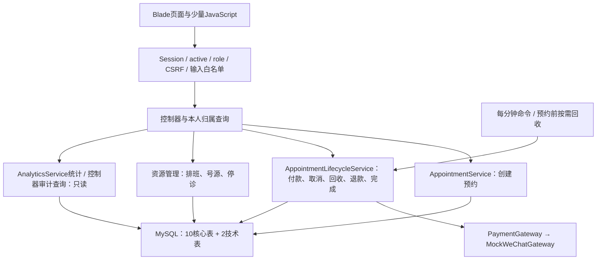
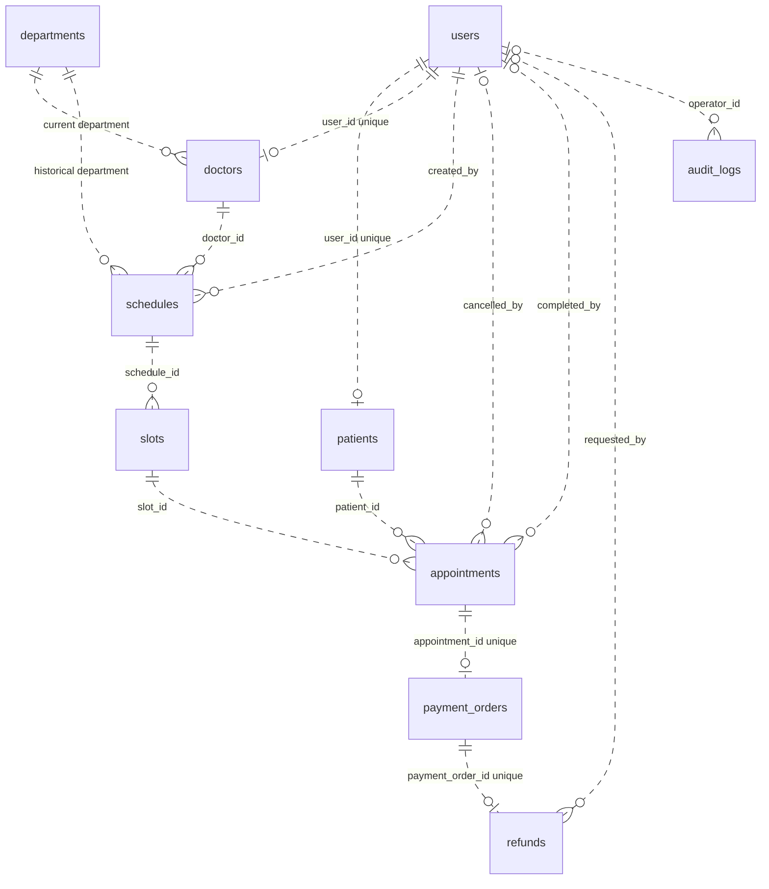
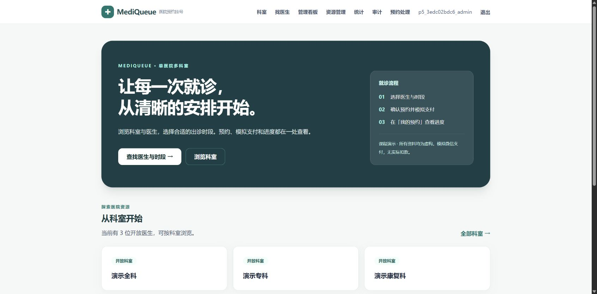
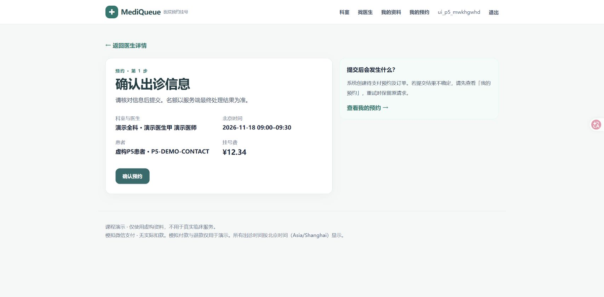
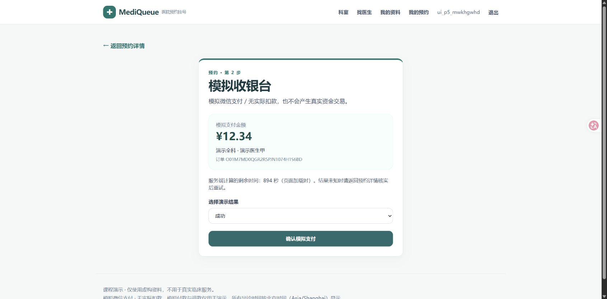
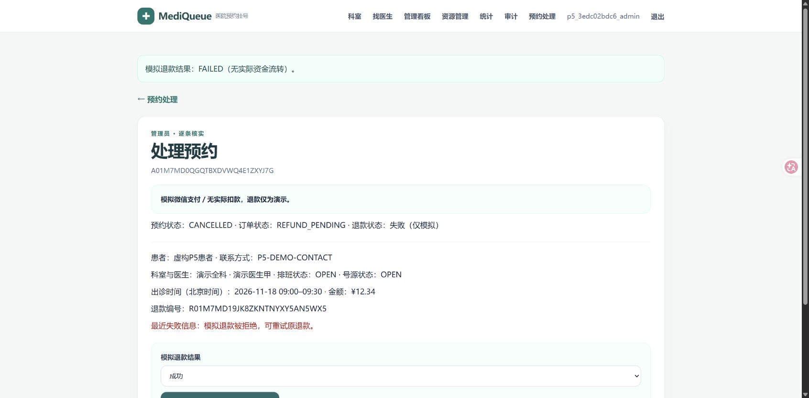
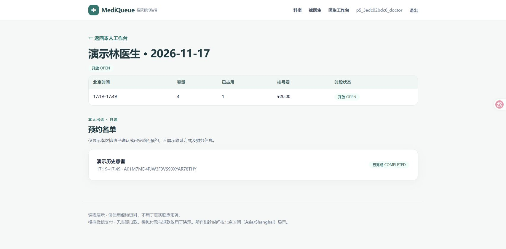
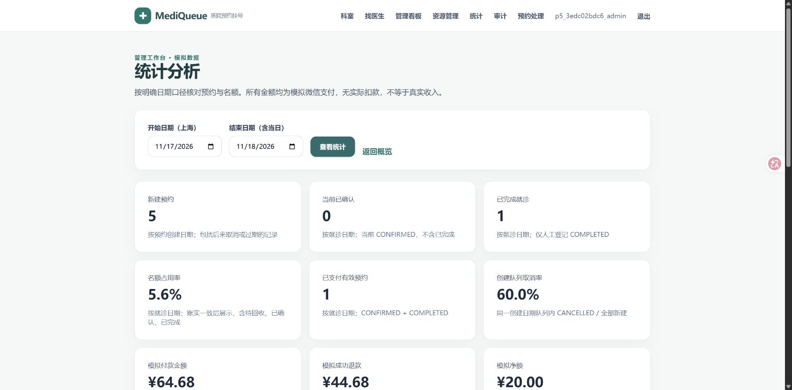
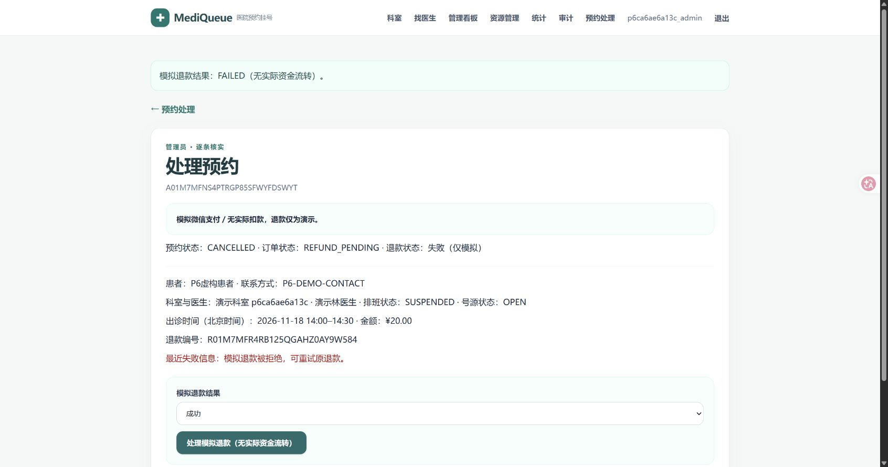

# MediQueue 医院预约挂号系统：数据库课程设计报告

版本：P6 课程报告。仓库：[SynapseOperator/MediQueue](https://github.com/SynapseOperator/MediQueue)。需求基线为三份V1.1规格，本文记录P0—P6工程、验收、性能与恢复事实，远端最终状态以最新PR和main检查为准。只使用合成数据和可追溯记录，不代表真实医院服务或安全认证。

**全部“付款、退款、净额”均为MOCK_WECHAT本地模拟，无微信商户接入、无真实资金流转。** 教师是否接受模拟方式满足任务书“在线挂号支付”，仍须课程验收方确认。

## 1. 题目概述

课题是单医院、多科室预约挂号Web应用。患者选择医生和时段，系统建立待支付预约；模拟付款成功后确认就诊，取消、过期、退款和人工完成均留下历史。重点是多个请求争抢名额时，预约、订单、容量和审计能否一致。

采用PHP 8.4 / Laravel 13、MySQL 8.4 / InnoDB、Blade / Tailwind CSS / Vite。任务书要求PHP或JSP与MySQL，本项目选择PHP。范围不含跨医院、家庭代挂号、病历处方、医保、短信、候补或微服务。规格中“尚未编码”的文字保留其形成时的历史，后续正式授权与实测记录另行留存，不改写冻结业务规则。

## 2. 需求与功能

| 使用者 | 已实现能力 | 关键限制 |
|---|---|---|
| 访客 | 开放科室、医生和排班；注册/登录 | 公开注册只能创建PATIENT |
| 患者 | 本人档案、确认预约、模拟收银台、历史、开始前取消 | 身份取Session，不信任传入patient_id；一账号一档案 |
| 医生 | 本人排班时间轴及已确认/已完成名单 | 只读，不管理排班，不读其他医生或无关财务资料 |
| 管理员 | 科室医生、排班号源、停诊逐项处理、退款、人工完成、统计审计 | 停诊不批量取消，完成需核实，失败退款继续可见 |
| 系统 | 定时与预约前按需回收 | 只在真实到期转换后释放，停用患者仍可清理 |

区间为半开`[start,end)`，相邻不冲突。创建立即占一个名额，截止为`min(锁内创建时间+15分钟, 时段开始)`。患者只在开始前取消；管理员可带原因处理尚未就诊的异常记录；COMPLETED不回退取消且不释放名额。完整AC对应关系见[验收矩阵](../archive/verification/p6-acceptance-matrix.md)。

## 3. 总体架构



一个PHP应用和一个MySQL实例，Session存数据库、缓存存文件、队列同步，没有为未来场景提前增加Redis或独立前端。HTTP账号仅业务DML与两个报告例程EXECUTE；普通迁移、测试库和短时函数DDL管理员凭据分离。

[schema runner](../../scripts/run-schema.php)固定已验证目标的DB变量，清除继承的URL/socket，拒绝缓存配置；只有短时CLI加载函数DDL管理员连接，不能将其缓存为常驻应用配置。[README](../../README.md)提供Windows原生MySQL与通用Compose两条启动路径，不能把两套独立数据源当作同一库。

本机按[Windows指南](../windows-demo.md)实际验证原生MySQL正常SHUTDOWN后，从原数据目录由启动器恢复，12表全行摘要前后一致；停止旧Laravel后由脚本重新启动、重复启动及`-CheckOnly`均退出0。新scheduler进程PID12608在10:21:00完成任务655.21ms，单次`schedule:run`在10:21:56完成444.13ms、退出0。这证明应用、数据库和调度进程重启可用，没有重启Windows，也没有配置开机自动服务。

## 4. ER概念设计

`schedules`是医生某日的一次出诊；`slots`是其中可售的时间段，每段可有多个名额。因此停诊和历史科室属于排班，容量和价格属于号源，不为每名患者复制安排。

下图表达数据库直接保障的基数：“零或一”不是允许成功预约无订单；成功时必有订单由事务保证。非空子FK必须引用一个父记录，父记录可暂时没有子记录。



审计`target_type/target_id`为多态逻辑目标，没有同时指向所有业务表的普通FK。`sessions`与`migrations`为技术表，不充作核心实体。完整字段ER和数据字典见[P1数据库结构](../architecture/p1-database-schema.md)。

## 5. 逻辑结构与规范化

| 关系 | 主职责、候选键与函数依赖 |
|---|---|
| users | id、username分别唯一决定账号属性；password_hash不混入患者资料 |
| patients | id或user_id决定姓名、联系方式；phone不是身份唯一键 |
| departments | id、code、name为候选键，决定介绍和状态 |
| doctors | id或user_id决定医生资料及当前科室；姓名不是键 |
| schedules | id或(doctor_id,work_date,session_code)决定一次排班；保留当次department_id |
| slots | id或(schedule_id,starts_at)决定区间、容量、现价；唯一起点不能证明任意区间不重叠 |
| appointments | id、appointment_no、(patient_id,request_key)决定预约事实；无patient/slot永久唯一 |
| payment_orders | id、order_no、appointment_id决定订单；跨表amount相等靠事务 |
| refunds | id、refund_no、payment_order_id决定一份全额退款义务；失败重试原行 |
| audit_logs | id决定操作者、动作、目标与必要状态快照；浏览不逐条记日志 |

各实体按职责拆分，避免在预约复制整个患者、医生和科室。但不能声称“全部表无条件严格3NF”：`occupied_count`是有意维护的汇总冗余；`appointments.fee_amount`和订单amount是发生时的历史金额，并非可随现价变化的派生值；`schedules.department_id`是历史出诊事实，不等于医生当前科室。审计JSON只存受控状态，不代替关系主体。

这些字段分别解决快速容量判断、历史价格稳定和历史归属稳定。代价是服务须同事务维护计数与状态，并提供核对查询；发现差异要调查，不能自动覆盖计数掩盖业务错误。

## 6. 物理设计、约束与索引

核心表InnoDB / utf8mb4，主外键BIGINT UNSIGNED；UTC存储与比较，DATETIME(3)保留毫秒，work_date是上海日历日期。金额DECIMAL(10,2)，PHP沿用字符串。状态为可读字符串+CHECK。请求键/业务号采用区分大小写、NO PAD的比较；用户名限定ASCII并规范化为小写。

P1实际元数据：10个业务主键、15个FK、14个唯一约束、33个CHECK。技术表另计；P5视图和例程不是业务表。

| 机制 | 直接保障 | 不能代替 |
|---|---|---|
| PK / NOT NULL | 行身份和必填字段 | 授权、事实是否真实发生 |
| FK RESTRICT | 引用存在，拒绝破坏被引用父记录 | 角色、所有末端历史不删、父子时间合法 |
| UNIQUE | 最多一份档案/订单/退款；请求身份唯一 | 至少一份、同键输入匹配、跨slot区间冲突 |
| CHECK | 容量范围、时间正序、本行状态/事件字段、模拟外部字段NULL | 跨表金额、计数账实、当前时间、合法状态转换 |
| 事务与锁 | 多表原子提交、受控并发顺序 | 绕过服务的手工SQL不会自动获得完整业务保证 |

CHECK不能引用其他表或子查询，也不能用NOW()自动到期；UNKNOWN可被接受，因此必填还需NOT NULL。[MySQL CHECK官方说明](https://dev.mysql.com/doc/refman/8.4/en/create-table-check-constraints.html)

重要索引按职责分工：`(patient_id,request_key)`幂等；`(patient_id,status,slot_id)`冲突候选；`(patient_id,created_at,id)`历史；`(slot_id,status,expires_at,id)`号源占用及按需回收；`(status,expires_at,id)`定时扫描；`(paid_at,id)`付款事实；`(target_type,target_id,created_at,id)`审计链。存在索引不等于查询已最优，实测见第11节。

## 7. 关键SQL、视图、过程与函数

四对象完整可执行定义在[reporting migration](../../database/migrations/2026_11_17_010000_create_reporting_objects.php)。

| 对象 | 用途与边界 |
|---|---|
| v_appointment_details | 八表关联预约、患者、号源、排班、医生、历史科室、订单、可选退款；一对一唯一键防放大 |
| v_slot_occupancy_check | 单SQL比较存储占用与待支付/确认/完成数量；含到期未回收，差值转SIGNED |
| sp_department_statistics | 上海work_date闭区间，容量与预约先分别聚合，再按科室关联 |
| fn_intervals_overlap | UTC DATETIME(3)半开区间；NULL/反向/零长抛45000；不读表，不替代锁 |

```sql
SELECT * FROM v_slot_occupancy_check
WHERE difference <> 0 ORDER BY slot_id;
CALL sp_department_statistics('2026-11-17', '2026-11-18');
SELECT fn_intervals_overlap('2026-11-17 01:00:00','2026-11-17 01:30:00',
                            '2026-11-17 01:30:00','2026-11-17 02:00:00');
```

相邻函数结果为0，核对视图只发现问题不修复。过程容量子查询只JOIN排班和slot，预约另行聚合；若直接对slot与预约JOIN后SUM，一个容量5且有3预约的slot会变15，本项目测试明确断言仍为5。

[AnalyticsService](../../app/Services/AnalyticsService.php)以一条CTE分开聚合创建队列、就诊预约、容量、付款及退款。创建趋势按上海created_at；确认/完成/容量按work_date；模拟付款按paid_at，成功退款按succeeded_at；取消率分子分母来自同一创建队列。净额可负，不是利润或实际收入。零分母“—”，账实差异显示“待核对”；历史科室取schedule。

对象为SQL SECURITY INVOKER，不提供行级身份授权，应用仍须ADMIN校验。总览单SQL内一致，过程、趋势和待处理列表是独立读语句，不宣称整页事务快照。详见[统计口径](../architecture/p5-analytics.md)和[SQL权限](../database/p5-sql.md)。

## 8. 事务与并发控制

占号与建单必须同时提交：先占号后建单的故障会留下无预约占用；先建预约后另建订单会留下无法支付的预约。本实现把条件占号、预约、订单和成功审计放在一次事务，任一步异常全部回滚。


同患者不同医生仍争用同一患者锁，READ COMMITTED下在锁后检查最新已提交预约。冲突条件`existing.start < target.end AND existing.end > target.start`，相邻可通过。只锁目标slot无法阻止同患者同时预约两个不同slot，因此患者锁有独立必要性。

slotX锁加`occupied_count < capacity`条件更新保护最后名额；父资源S锁与管理停诊X锁互斥，防止旧资格继续付款。共享/排他读及提交释放语义参见[MySQL锁定读](https://dev.mysql.com/doc/refman/8.4/en/innodb-locking-reads.html)。

生命周期顺序是患者→科室→医生→排班→号源→预约→订单→退款，按需保护账号。管理只从父到子，不在停诊锁内遍历患者。按需回收在创建正式事务外扫描候选，每条独立患者优先，避免号源→患者反向锁序。

| 事件 | 同事务结果 | 占用 |
|---|---|---|
| 创建 | PENDING_PAYMENT / UNPAID | +1 |
| 合法模拟付款 | CONFIRMED / PAID，保留首次时间 | 0 |
| 未付取消或到期 | CANCELLED或EXPIRED / CLOSED / released_at | -1一次 |
| 已付取消 | CANCELLED / REFUND_PENDING / 唯一PENDING退款 | -1一次 |
| 退款结果 | 原退款FAILED/PENDING/SUCCEEDED；成功订单REFUNDED | 0 |
| 人工完成 | COMPLETED / PAID，操作者和时间 | 0 |

到达截止即失去首次付款资格，清理延迟不延长付款，未回收仍占号。已成功处理的重复付款先返回原事实，不能因现在超时误判为新迟到事件。死锁/锁超时最多三次完整事务重试；提交结果未知先重连查原键或刷新原记录，不换业务号盲重放。这是当前入口和指定测试场景的保证，不承诺绝无死锁。

## 9. 功能实现与实际截图

以下复用2026-11-17的P5真实Chrome截图，均为合成资料，非本轮重新拍摄或效果图。详见[P5浏览器记录](../archive/verification/p5-browser.md)，数字仅代表对应时点。



图1：公开科室和医生入口，读取真实启用资源，无在线诊疗功能。



图2：本人资料、时间、金额核对。GET不占号，POST进入原事务。



图3：明确无实际扣款，Session、短期签名、CSRF和本人归属保护入口。



图4：失败为独立退款结果；预约仍取消、容量不回占，管理员沿原退款重试。



图5：本人CONFIRMED/COMPLETED名单，不展示患者联系方式和无关付款资料。



图6：日期、科室与创建趋势。P5人工样本容量18、占用1、模拟付款64.68、成功退款44.68、净额20.00，与[脱敏数据库证据](../archive/verification/p5-database.json)一致。

[P6浏览器记录](../archive/verification/p6-browser.md)另真实完成预约7本人取消退款成功、预约8停诊后逐条取消及同一退款FAILED→SUCCEEDED、历史合成预约6人工完成、看板/审计和医生只读名单。医生直接GET管理员资源页403；未在浏览器提交医生修改POST或尝试患者他人预约URL，这些仍由HTTP测试证明。本轮390px实际复核医生工作台、患者时段横向操作/确认/本人退款，以及管理员状态筛选/退款详情/统计/审计；移动补验只浏览已有业务，没有新增预约或修改状态。



图7：本轮停诊处理产生的原退款先失败，随后沿同一退款重试成功；这张图保留失败时刻，不用最终状态覆盖演示历史。

## 10. 测试与异常处理

本轮实际命令`php scripts/run-schema.php test --compact --no-ansi --log-junit test-results/p6-local-junit.xml`退出0：**234 tests、2939 assertions、0 failures / errors / skipped**，最终JUnit更新于2026-11-17 10:23:34 UTC，用例合计30.128145秒。[公开摘要](../archive/verification/p6-local-results.json)保留JUnit哈希及并发证据清单。P5为229测试，本轮新增P6直接验收3项、演示场景2项；远端最新提交CI单独确认。

| 测试层 | 源码 | 证明与限制 |
|---|---|---|
| 约束 | CoreSchemaTest / MysqlIntegrityTest | FK1452/1451、UQ1062、CHECK3819、NULL1048；合法状态也测 |
| 身份/HTTP | AuthFlowTest / AppointmentHttpTest / LifecycleHttpTest | 真Session、角色归属、真实CSRF专项、签名、字段白名单、生产禁用模拟 |
| 回滚 | AppointmentCreationTest / AppointmentLifecycleTest | INSERT后注入异常，逐表核对无部分写入 |
| 并发 | AppointmentConcurrencyTest / LifecycleConcurrencyTest / ResourceConcurrencyTest | 独立PID/连接、同步门闩、最后名额、跨医生、停诊及生命周期竞争 |
| 恢复 | AppointmentRecoveryTest / LifecycleRecoveryTest | 第二连接真实锁超时；真实COMMIT后受控响应异常，原标识查回 |
| SQL | ReportingSqlTest / ReportingMigrationTest / AnalyticsTest | 反放大、跨上海午夜、精确金额、差异只读、DDL可逆 |
| P6直接验收 | P6AcceptanceTest | 真实取消再约、新旧费快照、仍CONFIRMED开始后患者取消拒绝 |

P3实测20进程最后一号为1成功19拒绝；P4九类竞争核对状态、退款和计数。受控时钟、SQL异常注入与真实网络故障分开描述，不把两次网页点击当并发。

结果未知保留原请求键，提示查原记录。密码只存哈希，不回填；审计只记必要状态。没有将通过测试等同完成渗透测评。

CI保留quality/mysql/frontend/secrets，包括质量、依赖审计、前端构建、真实MySQL和Gitleaks；上传JUnit与并发JSON。P6最新PR和main结果在[阶段交付](../archive/verification/P6.md)所指的PR记录中核对，不用旧绿灯替代。

## 11. 性能实验

实测命令`php scripts/performance/run-v2.php`退出0，在独立库`mediqueue_perf_p6_v2`保存同版结构和5万预约/订单。100名合成患者每人500条不重叠预约，1000个slot各50条；全部是已过期未回收PENDING_PAYMENT / UNPAID，直接合成而非逐条走HTTP，不含逐操作审计。外键开启；关系、状态、金额、时间异常、患者重叠、无效哈希、容量账实差异均0。第一轮每患者一条的弱分布证据保留，不能据此证明历史索引收益。

环境为Windows / 24核32逻辑处理器 / 内存34,033,319,936字节 / MySQL8.4.13，buffer pool128MiB、binlog开启。独立PDO为服务器默认REPEATABLE READ，应用为READ COMMITTED；只比较只读查询，不能外推事务竞争。每查询预热一次再测7次，计时含本机PHP/PDO往返与取数。`IGNORE INDEX`仅影响对照SQL，没有删除索引或修改业务schema。完整SQL、7轮数据、结果SHA-256及执行计划见[性能报告](../performance/p6-report.md)和[v2 JSON](../performance/p6-results-v2.json)。

| 查询 | 正常中位数ms | 忽略目标索引ms | 实际计划与结论 |
|---|---:|---:|---|
| 到期候选前100条 | 0.3130 | 9.0846 | 正常状态/截止/id覆盖范围扫描取100；对照扫描5万行并排序 |
| 简化患者历史，按created_at/id取20条 | 0.2918 | 0.7091 | 正常历史索引倒序取20；对照取该患者500行后排序 |
| 1000slot占用核对 | 15.9117 | 110.8925 | 正常按slot关联索引查找；对照为更昂贵的扫描/哈希关联 |
| 实际八表历史页面，按id降序取20条 | 2.4467 | 2.4713 | 正常用patient_id/request_key唯一索引取得500行再排序；未使用created_at历史索引 |

每组两种计划的结果哈希相同。重要发现是**简化历史查询收益不等于当前页面收益**：当前页面按id排序，计划没有使用被比较的created_at索引，两次差异不足以支持优化结论，且未包含分页count查询。没有据此新增业务索引。

EXPLAIN ANALYZE实际执行语句，给出迭代时间/行数，不是客户端整条耗时；不能把估算cost当毫秒。[MySQL EXPLAIN官方说明](https://dev.mysql.com/doc/refman/8.4/en/explain.html) 本实验为均匀、单状态、顺序热缓存数据，不是混合历史负载或生产压测；没有测量写入开销及索引空间，因此不宣称整体收益或生产SLA。

## 12. 备份恢复

[backup-restore.php](../../scripts/backup-restore.php)已将源`mediqueue`逻辑备份并恢复到最终复核的新库`mediqueue_restore_p6_20261117_verified`，命令参数包含本机MySQL工具目录与唯一label，不覆盖已有目标。公开[原始摘要](../archive/verification/p6-backup-results.json)记录：

| 实际步骤 | 退出码 | 秒 |
|---|---:|---:|
| schema导出（含例程/视图） | 0 | 0.087072 |
| data导出 | 0 | 0.065808 |
| schema恢复 | 0 | 0.318114 |
| data恢复 | 0 | 0.059522 |

恢复前后12表全行有序SHA-256一致：17用户、10患者、4科室、4医生、6排班、8号源、8预约、8订单、5退款、40审计、1会话、12迁移记录。结构核对为12PK（含技术表）、15FK、14UNIQUE、33CHECK、2视图、1过程、1函数，例程INVOKER保留。15条FK孤立数均0，容量、缺订单、预约/订单金额和退款金额差异均0。

随后用临时独立DML+两个EXECUTE账号在恢复库调用原服务并真实提交：新预约9→CONFIRMED→CANCELLED→退款FAILED→原退款SUCCEEDED，订单REFUNDED、占用回到原值、账实差异0。源库在备份期间及恢复业务验证前后哈希未变；不是仅证明SQL导入成功。测试用账号及临时凭据文件最终删除。

核心表为InnoDB，mysqldump单事务可取事务表一致快照，但备份期间应避免DDL。[MySQL mysqldump官方说明](https://dev.mysql.com/doc/refman/8.4/en/mysqldump.html) 本次schema/data分开导出，要求演示停止写入，并以前后指纹核验源未变化；不是不停写情况下的跨两次导出一致性保证。SQL文件也不等同运行配置、数据库账号权限或完整系统镜像。

原始SQL含账号哈希与会话，只留ACL受限`.local/backups/20261117_verified`，不提交。早先`20261117_final`恢复库也保留，没有覆盖删除。公开摘要包含文件大小与校验和，不含行数据或凭据。此次为同机MySQL8.4.13逻辑恢复演练，不声称跨版本、异机灾难或按binlog时间点恢复已经验证。完整实际子命令、导出权限、外键核验和边界见[备份恢复记录](../archive/verification/p6-backup-restore.md)。

## 13. 总结与改进

项目将关系建模、SQL约束、短事务、锁顺序和页面权限落实为同一可运行系统。需要区分“字段合法”“多表一致”和“并发仍正确”：唯一键不代替同事务建单，CHECK不代替跨表业务判断，按钮禁用不代替权限，未知提交不能当失败重做。

边界包括单机文件缓存/限流、逐条退款、统计多读语句瞬时差异、原生MySQL和调度器需启动、性能数据不能推断生产SLA。未来依据真实需求扩展运维恢复演练与数据分布验证；真实支付须另设计验签、异步事实和补偿，不能只替换类名即称接通。本期不新增这些功能。

本地29项适用AC均已有对应证据，AC-22条件不适用。远端最新提交四项CI和合并后main仍单独核对，不能用本地结果替代。模拟能否满足课程支付评分仍为外部确认，不保证成绩。

## 14. 参考资料与附录

业务规则来自项目规格，不由数据库手册决定：

- [PRD V1.1](../spec/MediQueue_PRD_V1.1.md)、[数据库设计](../spec/MediQueue_Database_Design_V1.1.md)、[模拟支付设计](../spec/MediQueue_Mock_WeChat_Payment_Design_V1.1.md)。
- [字段字典与ER](../architecture/p1-database-schema.md)、[预约ADR](../architecture/adr-0004-p3-appointments.md)、[生命周期ADR](../architecture/adr-0005-p4-lifecycle.md)、[统计口径](../architecture/p5-analytics.md)、[SQL权限](../database/p5-sql.md)。
- [AC矩阵](../archive/verification/p6-acceptance-matrix.md)、[P3](../archive/verification/P3.md)、[P4](../archive/verification/P4.md)、[P5](../archive/verification/P5.md)、[答辩提纲](defense-outline.md)。

2026-11-17实际在线核对的官方技术参考：

1. [MySQL 8.4 CHECK Constraints](https://dev.mysql.com/doc/refman/8.4/en/create-table-check-constraints.html)：本行表达式、NULL与限制。
2. [MySQL 8.4 Locking Reads](https://dev.mysql.com/doc/refman/8.4/en/innodb-locking-reads.html)：共享/排他保护与提交释放。
3. [MySQL 8.4 EXPLAIN](https://dev.mysql.com/doc/refman/8.4/en/explain.html)：估算与实际迭代统计。
4. [MySQL 8.4 mysqldump](https://dev.mysql.com/doc/refman/8.4/en/mysqldump.html)：单事务备份及并发DDL限制。

源码附录：`database/migrations/`为可执行结构，`app/Services/`为业务写入口，`tests/Feature/`为真实MySQL测试，`docs/archive/verification/`为实际阶段记录和截图。复现前读README并选择正确数据源，不使用`migrate:fresh`清空已有业务库。
